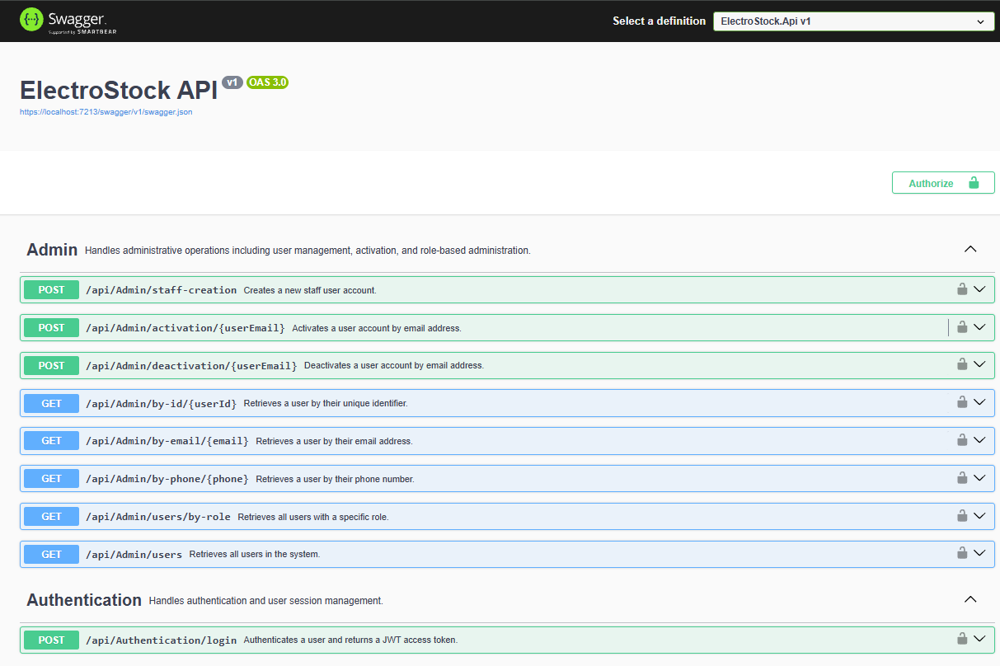
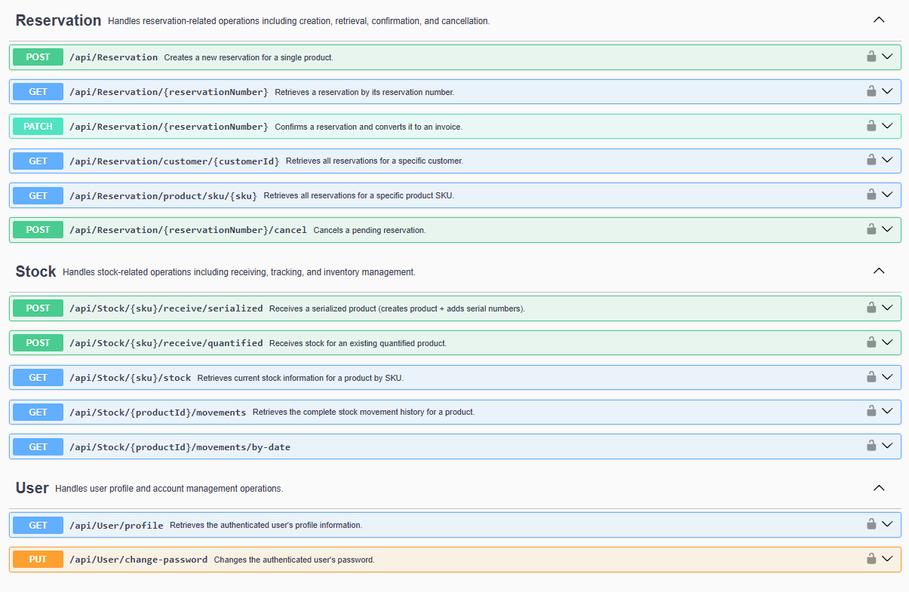
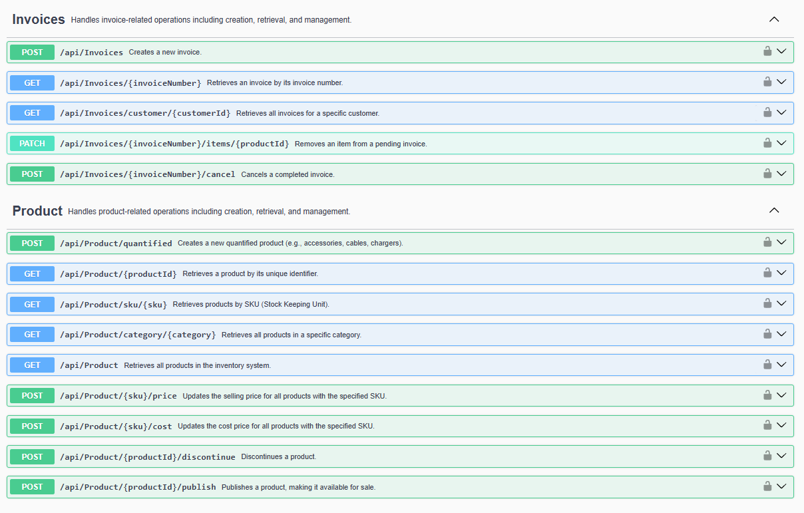
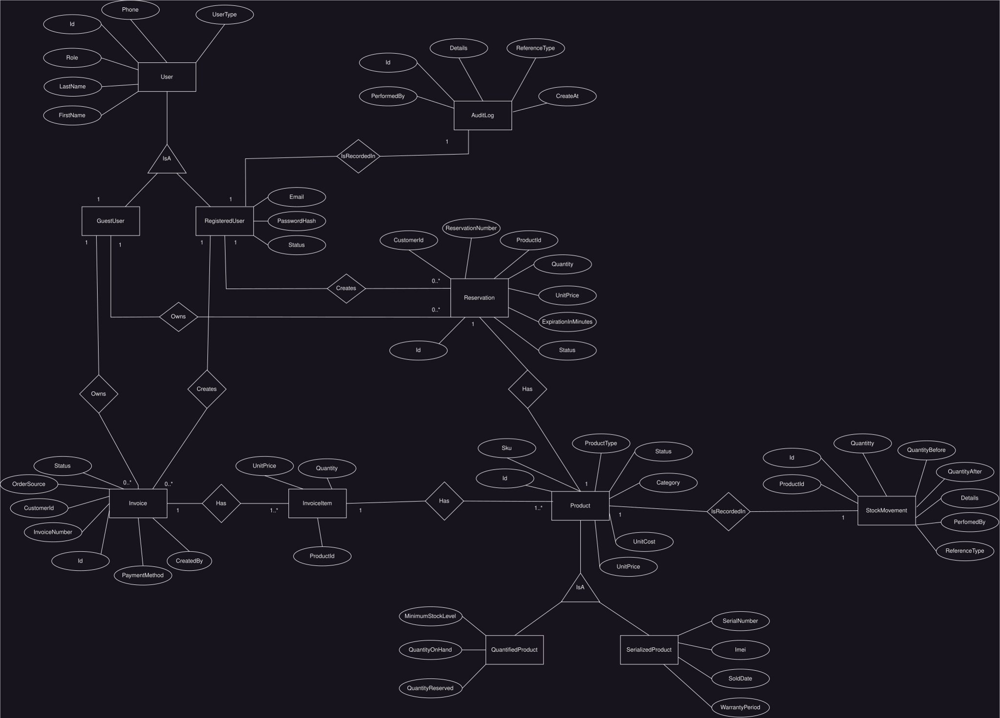
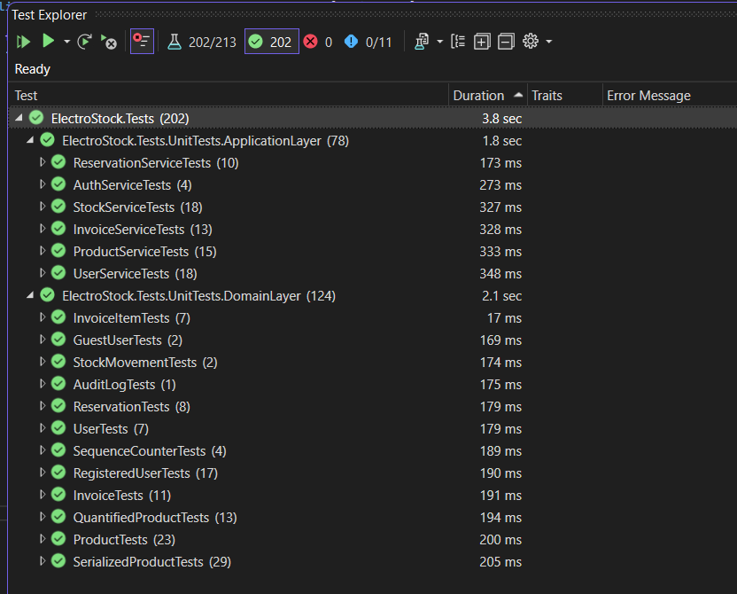
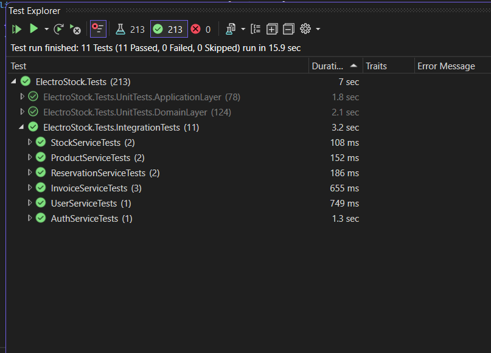

# ElectroStock

ElectroStock is an ASP.NET Core Web API for managing electronics inventory, reservations, invoices, stock movements, users, and audit records.

The project was built as a backend portfolio application to demonstrate C#, ASP.NET Core, domain-oriented design, Entity Framework Core, SQL Server, JWT authentication, Docker, and automated testing.

## Quick Start (Docker)

```bash
# 1. Clone and run in 60 seconds
git clone https://github.com/AhmedMostafa79/ElectroStock.git
cd ElectroStock


# 2. Start everything with one command
docker compose up --build -d

# 3. Access the application
# Swagger UI: http://localhost:8080/swagger
# API: http://localhost:8080
```

### Default Administrator Account

The application automatically seeds an **Administrator account** on first run so the API can be explored locally:

**Credentials:**

- **Email**: `admin@gmail.com`
- **Password**: `Admin@123`
- **Role**: `Admin`

> **Important:** These credentials are for local demonstration only. Replace the seed values and JWT configuration before using the application in a real environment.

**Administrator capabilities:**

- Create and manage staff accounts.
- Activate and deactivate users.
- Search and list users by ID, email, phone, or role.
- Manage products, pricing, publishing, and discontinuation.
- Receive stock and view stock movement history.
- Create, confirm, and cancel reservations.
- Create, update, and cancel invoices.

## Preview



<details>
<summary>📂 More screenshots (click to expand)</summary>

### Reservations, Stock & Users


### Products & Invoices


</details>

## Table of Contents

- [Project Highlights](#project-highlights)
- [Technical Achievements](#technical-achievements)
- [Technical Architecture](#technical-architecture)
- [Core Features](#core-features)
- [Technology Stack](#technology-stack)
- [Known MVP Limitations](#known-mvp-limitations)
- [Future Enhancements](#future-enhancements)
- [Design Patterns and Principles](#design-patterns-and-principles)
- [Project Structure](#project-structure)
- [Security Implementation](#security-implementation)
- [API Documentation](#api-documentation)
- [Database Design](#database-design)
- [Testing Strategy](#testing-strategy)
- [Docker and Containerization](#docker-and-containerization)
- [Getting Started](#getting-started)
- [Configuration](#configuration)
- [Author & Contact](#author--contact)
- [License](#license)
- [Acknowledgments](#acknowledgments)

## Project Highlights

- Electronics inventory management API built with ASP.NET Core 8.
- Supports both quantity-based and serialized products.
- Tracks available, reserved, sold, and discontinued stock states.
- Supports reservations, invoice creation, cancellation, and stock refunds.
- Uses JWT bearer authentication with role-based authorization.
- Uses Entity Framework Core and SQL Server for persistence.
- Includes domain and application-service tests.
- Includes SQL Server integration tests using Testcontainers.
- Includes a multi-stage Dockerfile and Docker Compose configuration.
- Provides Swagger/OpenAPI documentation in the Development environment.

## Technical Achievements

- Modeled different inventory behaviors using `QuantifiedProduct` and `SerializedProduct` domain entities.
- Encapsulated business transitions such as reserve, confirm sale, cancel, refund, publish, and discontinue inside domain models.
- Implemented invoice and reservation number generation using date-based sequences such as `INV-20261020-0001` and `RES-20261020-0001`.
- Added transaction handling around important inventory workflows.
- Added stock movement and audit logging for operational traceability.
- Configured TPH inheritance for products and users through Entity Framework Core.
- Added automatic database migration and administrator seeding during application startup.
- Added a Swagger authorization definition for testing authenticated endpoints with bearer tokens.

## Technical Architecture

The application follows a layered architecture:

```text
+-----------------------------+
| ElectroStock.Api            |
| Controllers, middleware,   |
| Swagger, authentication    |
+-------------+---------------+
              |
+-------------v---------------+
| ElectroStock.Application   |
| DTOs, services, interfaces, |
| mappings, application rules |
+-------------+---------------+
              |
+-------------v---------------+
| ElectroStock.Domain        |
| Entities, value objects,   |
| enums, domain contracts     |
+-------------+---------------+
              |
+-------------v---------------+
| ElectroStock.Infrastructure|
| EF Core, repositories,      |
| SQL Server, seeding         |
+-----------------------------+
```

### Main responsibilities

- **API:** HTTP endpoints, authentication setup, authorization attributes, Swagger, and exception handling middleware.
- **Application:** Use cases, DTOs, service orchestration, mapping, and application interfaces.
- **Domain:** Product, user, reservation, invoice, and stock domain behavior.
- **Infrastructure:** EF Core contexts, repositories, migrations, password hashing, sequence persistence, and database seeding.
- **Tests:** Unit tests and SQL Server integration tests.

## Core Features

### Product management

- Create quantified products.
- Receive serialized products with serial numbers, optional IMEI, and warranty information.
- Retrieve products by ID, SKU, category, or all products.
- Update product selling price and cost.
- Publish and discontinue products.

### Inventory and stock

- Receive quantity-based stock.
- Reserve available stock.
- Confirm sales and deduct stock.
- Release reservations.
- Refund stock after invoice cancellation or item removal.
- Query current stock information.
- Query stock movement history by product and date range.

### Reservations

- Create a reservation for a product.
- Track pending, confirmed, cancelled, and expired reservation states.
- Confirm a reservation and create an invoice.
- Cancel a pending reservation and release reserved stock.
- Retrieve reservations by number, customer, or product SKU.

Reservations currently support one product per reservation as an MVP design choice.

### Invoices

- Create invoices containing multiple items.
- Generate date-based invoice numbers.
- Retrieve invoices by invoice number or customer.
- Remove items from pending invoices.
- Cancel completed invoices and restore stock.

### Users and administration

- Authenticate users with email and password.
- Seed an initial administrator account.
- Create staff accounts.
- Activate and deactivate users.
- Search users by ID, email, or phone.
- List users by role or list all users.
- View the authenticated user's profile.
- Change the authenticated user's password.

## Technology Stack

| Area | Technology |
|---|---|
| Language | C# |
| Framework | ASP.NET Core 8 Web API |
| Runtime | .NET 8 |
| ORM | Entity Framework Core |
| Database | Microsoft SQL Server 2022 Express |
| Authentication | JWT Bearer Authentication |
| API documentation | Swagger / OpenAPI with Swashbuckle |
| Password hashing | BCrypt.Net-Next |
| Testing | xUnit, FluentAssertions, Moq |
| Integration testing | Testcontainers for SQL Server |
| Containerization | Docker and Docker Compose |


## Known MVP Limitations

- Reservations currently contain one product rather than multiple reservation items.
- There is no frontend application in this repository.
- Guest customers are created through business workflows; there is no separate customer registration endpoint.
- Reservation expiration processing is prepared at the domain level but does not currently require a background worker for the MVP.
- Docker Compose is intended for local development and demonstration.
- API-level HTTP integration tests are not currently included; integration tests focus on application services and persistence.
- Pagination, filtering, and sorting are limited for collection endpoints.
- Production-grade secret management, observability, and deployment orchestration are outside the project scope.

## Future Enhancements

- Add a background service for expired-reservation processing.
- Add API-level integration tests for controllers, authorization, middleware, and routing.
- Add optimistic concurrency handling for stock updates.
- Add database constraints for identifiers such as serial numbers and IMEIs where required by business rules.
- Add pagination and richer search/filter options.
- Add refresh tokens and token revocation.
- Add structured logging, health checks, and metrics.
- Add a frontend client for warehouse, cashier, and administration workflows.
- Add multi-company or tenant support if the domain expands beyond a single organization.


## Design Patterns and Principles

The project applies the following patterns and principles in a practical portfolio-scale implementation:

- **Layered architecture:** Separates API, application, domain, and infrastructure concerns.
- **Dependency inversion:** Application and domain contracts are implemented by infrastructure services and repositories.
- **Repository pattern:** Encapsulates data access for products, users, invoices, reservations, stock movements, and sequence counters.
- **Unit of Work pattern:** Coordinates EF Core transactions and persistence for multi-step workflows.
- **DTO pattern:** Keeps request and response models separate from domain entities.
- **Domain model pattern:** Entities protect state transitions through methods such as `Reserve`, `ConfirmSale`, `Cancel`, `Publish`, and `Discontinue`.
- **Middleware pattern:** Centralizes exception translation and error responses.
- **Options pattern:** Binds JWT and administrator seed settings from configuration.
- **Strategy-like polymorphism:** Quantified and serialized products implement different stock behavior through overridden domain methods.
- **TPH inheritance:** Represents related product and user types in shared database tables.

## Key Design Decisions

ElectroStock makes several deliberate trade-offs. The full reasoning is
documented in [`docs/DECISIONS.md`](docs/DECISIONS.md) using the
[ADR format](https://cognitect.com/blog/2011/11/15/documenting-architecture-decisions).

| # | Decision | Core rationale |
|---|----------|----------------|
| 1 | **BCrypt over ASP.NET Core Identity** | cross-language standard, simpler for a JWT-only API. |
| 2 | **Two DbContexts (App + Audit)** | Failure audit logs must survive transaction rollback. A second context gives a clean change tracker, so the rollback doesn't re-save rolled-back changes. |
| 3 | **TPH for Products and Users** | Simpler schema, no joins. Trade-off: nullable subtype columns. |
| 4 | **Asymmetric product creation** | Serialized products are created atomically with the first receipt (create + receive); quantified products are created as catalog entries and received later. |
| 5 | **Integration tests for transactional flows** | Mocks cannot reproduce TPH mapping, transaction rollback, or real concurrency. 11 integration tests cover the flows where those bugs live. |


See [`docs/DECISIONS.md`](docs/DECISIONS.md) for context, alternatives
considered, and trade-offs for each decision, plus a list of
[open questions](docs/DECISIONS.md#open-questions-future-adrs) that would
become future ADRs.

## Project Structure

```text
ElectroStock/
├── Dockerfile
├── docker-compose.yml
├── README.md
├── docs/
│   └── Diagrams/
└── src/
    ├── ElectroStock.Api/
    │   ├── Controllers/
    │   ├── Filters/
    │   ├── Helpers/
    │   ├── Middleware/
    │   ├── Program.cs
    │   └── appsettings*.json
    ├── ElectroStock.Application/
    │   ├── Dtos/
    │   ├── Helpers/
    │   ├── Interfaces/
    │   ├── Mappings/
    │   └── Services/
    ├── ElectroStock.Domain/
    │   ├── Enums/
    │   ├── Interfaces/
    │   ├── Models/
    │   └── ValueObjects/
    ├── ElectroStock.Infrastructure/
    │   ├── Migrations/
    │   ├── Repositories/
    │   ├── Seed/
    │   ├── AppDbContext.cs
    │   └── AuditDbContext.cs
    └── ElectroStock.Tests/
        ├── IntegrationTests/
        └── UnitTests/
```

## Security Implementation

- JWT bearer authentication.
- Role claims included in generated tokens.
- Role-based authorization for administrative, warehouse, cashier, and authenticated-user operations.
- BCrypt password hashing.
- Development user secrets support through ASP.NET configuration.
- Centralized handling of unauthorized and forbidden requests in API behavior and Swagger documentation.

### Demo credentials

The project includes development/demo seed configuration so the application can be explored locally. These values are intended for local demonstration only and must be replaced before any real deployment.

Do not reuse development JWT keys, database passwords, or administrator passwords in production.

## API Documentation

All API routes use the `api/[controller]` convention.

Swagger is available in the Development environment at:

```text
http://localhost:8080/swagger
```

### Endpoint groups

| Controller | Main responsibility | Authorization |
|---|---|---|
| `AuthenticationController` | Login and JWT token issuance | Anonymous login |
| `AdminController` | Staff and user administration | Admin |
| `ProductController` | Product catalog management | Admin, Warehouse, Cashier depending on endpoint |
| `StockController` | Receiving and stock movements | Admin, Warehouse |
| `ReservationController` | Reservation lifecycle | Admin, Cashier |
| `InvoicesController` | Invoice lifecycle | Admin, Cashier |
| `UserController` | Current profile and password changes | Any authenticated user |

### Representative routes

```text
POST  /api/Authentication/login
GET   /api/Product
GET   /api/Product/{productId}
POST  /api/Product/quantified
POST  /api/Stock/{sku}/receive/serialized
POST  /api/Stock/{sku}/receive/quantified?quantity=50
GET   /api/Stock/{sku}/stock
POST  /api/Reservation
PATCH /api/Reservation/{reservationNumber}?method=Cash
POST  /api/Reservation/{reservationNumber}/cancel
POST  /api/Invoices
GET   /api/Invoices/{invoiceNumber}
POST  /api/Invoices/{invoiceNumber}/cancel
GET   /api/User/profile
PUT   /api/User/change-password
```

Use the Swagger UI for complete request and response schemas.


## Database Design

The application uses SQL Server through Entity Framework Core.

### Entity-Relationship Diagram



> **Note:** Both `Products` and `Users` use **Table-Per-Hierarchy (TPH)** to store related subtypes in a single table:
> - `Products` uses a `ProductType` discriminator to distinguish `QuantifiedProduct` from `SerializedProduct`.
> - `Users` uses a `UserType` discriminator to distinguish `RegisteredUser` from `GuestUser`. Registered-only columns (`Email`, `PasswordHash`, `Status`) are `NULL` for guest rows.

### `AppDbContext`

Contains:

- Users
- Products
- Invoices
- Invoice items
- Reservations
- Sequence counters
- Stock movements
- Audit logs

It configures product and user TPH inheritance, owned invoice items, and sequence-counter persistence.

### `AuditDbContext`

Provides a separate EF Core context for audit persistence and audit-specific operations while using the configured SQL Server connection.

### Migrations

Migrations are located in:

```text
src/ElectroStock.Infrastructure/Migrations
```

For this portfolio/MVP application, pending `AppDbContext` migrations are applied during application startup before administrator seeding.

## Testing Strategy

The test project includes:

- Domain unit tests for products, users, invoices, reservations, stock movements, and sequence counters.
- Application service tests using Moq and FluentAssertions.
- Integration tests using real SQL Server containers.
- Testcontainers fixtures for database setup and migration execution.

Run the test project with:

```powershell
dotnet test src/ElectroStock.Tests/ElectroStock.Tests.csproj
```
Integration tests require Docker because they start a SQL Server container. Unit tests cover domain and application behavior without requiring the application containers.
### Test Results

**Unit Tests** — ~202 tests, fast, no Docker required:



**Integration Tests** — ~11 tests against real SQL Server via Testcontainers:




## Docker and Containerization

The application uses a multi-stage Docker build:

1. Restore dependencies using the .NET 8 SDK image.
2. Build and publish the API.
3. Run only the published output in the smaller ASP.NET Core runtime image.

Docker Compose defines:

- `sqlserver`: SQL Server 2022 Express with a persistent volume.
- `electro-stock`: the API container exposed on port `8080`.

Start the application with:

```powershell
docker compose up --build
```

Open Swagger at:

```text
http://localhost:8080/swagger
```

Stop the containers with:

```powershell
docker compose down
```

The database volume can be removed when a completely fresh local database is required:

```powershell
docker compose down -v
```

## Getting Started

### Prerequisites

Install the following:

- .NET 8 SDK
- SQL Server, or Docker Desktop for the Compose workflow
- Git
- Optional: an API client such as Swagger UI, Postman, or Insomnia

### Run locally with the .NET SDK

1. Clone the repository.
2. Configure a local SQL Server connection in application configuration or user secrets.
3. Open a terminal at the repository root.
4. Run the API project:

```powershell
dotnet run --project src/ElectroStock.Api/ElectroStock.Api.csproj
```

5. Open the Swagger URL shown by the application, commonly:

```text
https://localhost:7213/swagger
```


## Configuration

ASP.NET Core nested configuration uses double underscores when represented as environment variables.

### Connection string

```text
ConnectionStrings__DefaultConnection
```

### JWT settings

```text
JWT__Key
JWT__Issuer
JWT__Audience
JWT__DurationInMinutes
```

### Administrator seed settings

```text
AdminSeed__Email
AdminSeed__Password
AdminSeed__Phone
AdminSeed__FirstName
AdminSeed__LastName
```

For local development, use .NET User Secrets or a local ignored `.env` file. Never use development credentials or JWT keys for a real deployment.


## Author & Contact

**Ahmed Mostafa** — Junior .NET Backend Developer

- **GitHub**: [github.com/AhmedMostafa79](https://github.com/AhmedMostafa79)
- **LinkedIn**: [linkedin.com/in/ahmed-khater-profile](https://www.linkedin.com/in/ahmed-khater-332121259)
- **Email**: ahmedkhater7779@gmail.com

## License

This project is licensed under the [MIT License](LICENSE).

## Acknowledgments

- ASP.NET Core and .NET documentation
- Entity Framework Core documentation
- Microsoft SQL Server documentation
- xUnit, FluentAssertions, Moq, and Testcontainers projects
